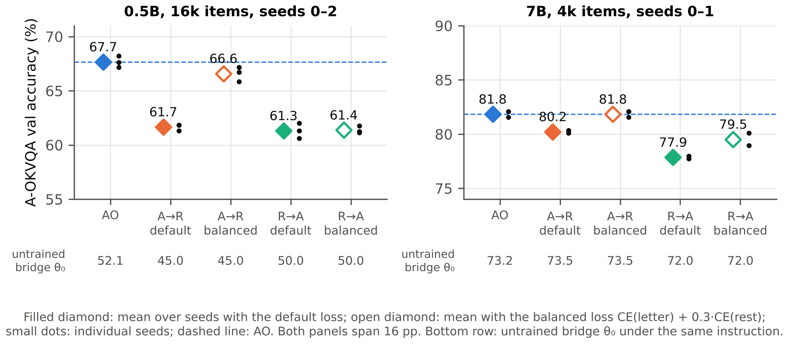

# Cross-Modal Reasoning with LLMs and Computer Vision

Code, results and trained weights for NTU final-year project **CCDS25-1134**
(Manikandan Praveen Kannappan; supervisor Dr Zhang Jiehuang).
Repository: https://github.com/Pkanna10/fyp-ccds25-1134; the predictions, training logs and trained
bridges are the assets of release [v1.0](https://github.com/Pkanna10/fyp-ccds25-1134/releases/tag/v1.0).

Only the **bridge** between a frozen **SigLIP-so400m** encoder and a frozen **Qwen2-0.5B / 7B**
LLM is trained (a 2-layer MLP, initialised from the LLaVA-OneVision projector), on **A-OKVQA**
multiple choice, with three targets:

| Target | The LLM is trained to write |
|---|---|
| AO | the answer letter |
| A→R | the answer letter, then the human rationale |
| R→A | the human rationale, then the answer letter |



*Main result (report Figure 1.2), A-OKVQA val accuracy on matched seeds. Each column is one
training target. A filled diamond is the mean over seeds with the default loss, the mean
cross-entropy over all target tokens; an open diamond is the mean with the balanced loss,
CE(letter) + 0.3 · CE(rest), which weights the answer letter on its own. The small dots are the
individual seeds, and the dashed line marks AO. The row under each panel gives the accuracy of
the untrained bridge θ₀ (the released LLaVA-OneVision projector) under the same instruction,
so the gain from training can be read for every column. Both panels span 16 pp.*

## Main results

A-OKVQA val accuracy (%), mean ± SD over seeds (report Table 4.3). 4k = 4,000 training
questions, 16k = all 16,024.

| LLM | Data | AO | A→R | R→A |
|---|---|---|---|---|
| Qwen2-0.5B | 4k | 61.4 ± 0.5 | 52.1 ± 1.1 | 55.0 ± 0.5 |
| Qwen2-0.5B | 16k | 67.4 ± 0.5 | 61.6 ± 0.3 | 61.3 ± 0.5 |
| Qwen2-0.5B, balanced loss (λ = 0.3) | 16k | 67.7 ± 0.5 | 66.6 ± 0.7 | 61.4 ± 0.3 |
| Qwen2-7B | 4k | 81.7 ± 0.3 | 80.1 ± 0.3 | 77.6 ± 0.4 |
| Qwen2-7B | 16k | 83.1 ± 0.7 | 81.3 ± 0.9 | – |

No rationale target exceeded AO in any setting tested. Weighting the answer letter on its own (balanced loss)
removes most of the A→R cost but not the R→A cost.

## Layout

```
src/cmr/              library: bridge model, training targets and loss, evaluation, statistics
configs/              bridge specifications (0.5B, 7B, 0.5B with 196 / 81 image tokens)
experiments/cloud/    cloud jobs (Modal) and the analyses for Tables 4.1–4.6
experiments/laptop/   laptop runs: option orders, SigLIP fusion, explanations, transfer, speed
experiments/analysis/ analyses behind individual numbers in the report
scripts/              data and release download, report tables and figures
results/              run summaries, metrics, table CSVs, analysis outputs (see results/README.md)
tests/                unit and end-to-end tests (tiny fake models, no downloads)
```

## Setup

```bash
git clone https://github.com/Pkanna10/fyp-ccds25-1134 && cd fyp-ccds25-1134
pip install -e ".[models,dev,figures]"      # or: pip install -r requirements-lock.txt && pip install -e . --no-deps
pytest -m "not slow"
bash scripts/download_data.sh               # A-OKVQA + COCO into data/raw/ (--train adds training images)
bash scripts/download_release.sh            # predictions, logs and trained bridges into results/runs/
```

SigLIP and Qwen2 download from the Hugging Face Hub on first use. `results/checkpoints.csv` lists
every released bridge with its settings, accuracy and SHA-256.

## Reproducing the report

**Tables and figures from the stored results** (CPU). Without the release assets, only
`make_report_tables.py` (Tables 4.1, 4.3, 4.6, F.1) and the figures drawn from
`results/run_metrics.json` can be regenerated; every other script reads the predictions and
training logs in the release assets, so run `scripts/download_release.sh` first. The example
figures (1.1, 3.1, 3.4, 4.6, 4.7) also need the A-OKVQA and COCO data (`scripts/download_data.sh`).

```bash
python scripts/make_report_tables.py                              # Tables 4.1, 4.3, 4.6, F.1
python experiments/cloud/analyze_phase1.py results/runs/cloud     # Tables 4.2, 4.4
python experiments/cloud/analyze_phase2_hp.py results/runs/cloud  # Tables 4.4 (7B), 4.5
python experiments/cloud/analyze_bal.py results/runs/cloud        # Table 4.6 contrasts
python scripts/make_figures.py && python scripts/make_pipeline_figures.py \
  && python scripts/make_example_figure.py                        # all report figures
python experiments/analysis/report_numbers.py                     # 185 numbers quoted in the text
```

**Evaluate a released bridge** (GPU or Apple silicon, ~15 min at 0.5B):

```bash
python -m cmr.runners.stage_a --model bridge:configs/ov_qwen2_05b_frozen.json \
  --projector results/runs/cloud/G05_B_answer_only_full_s0/projector.pt \
  --aokvqa-dir data/raw/aokvqa --coco-dir data/raw/coco --conditions real,swapped \
  --rotations 4 --device mps --dtype float32 --out runs/check
# expected: 67.6% with the real image (67.8% on Apple silicon)
```

**Train a bridge** (each run's exact arguments are in its `run_args.json`):

```bash
python -m cmr.runners.stage_b --bridge configs/ov_qwen2_05b_frozen.json --target answer_then_rationale \
  --train-limit 4000 --aokvqa-dir data/raw/aokvqa --coco-dir data/raw/coco \
  --prior-run results/runs/laptop/pilot_a1v2_instrument --conditions real,swapped --rotations 4 \
  --device mps --dtype bfloat16 --eval-dtype float32 --batch-size 1 --grad-accum 16 \
  --select last --seed 0 --out runs/a2r_4k_s0        # add --rationale-weight 0.3 for the balanced loss
```

The full cloud study is `experiments/cloud/launch.sh`; the laptop runs are
`experiments/laptop/run_mac_*.sh`.

### Report → code

| Report | Script |
|---|---|
| Tables 4.1–4.6, F.1; all figures | `scripts/make_report_tables.py`, `experiments/cloud/analyze_*.py`, `scripts/make_*figure*.py` |
| Table 4.7 (text-only check) | `experiments/analysis/text_context_table.py` |
| Table 4.8, 4.9 (explanations, steering) | `experiments/analysis/report_numbers.py` (R→A rows, from the cloud predictions), `experiments/laptop/explanation_checks.py` (A→R rows, Table 4.9) |
| Table 4.10 (option orders, SigLIP fusion) | `experiments/laptop/order_average.py`, `siglip_option_scores.py`, `fuse_siglip.py` (outputs in `results/analysis/`) |
| Tables 4.11, 4.12 (shuffled options, fewer tokens) | `experiments/laptop/run_mac_AB.sh`, `experiments/analysis/option_shuffle_table.py` |
| Table 4.14 (laptop speed-ups) | `experiments/laptop/mac_bench*.py` |
| Table 4.15 (LoRA, controls) | `cmr.runners.stage_b` with the arguments in `results/runs/laptop/mac_extra/` |
| Table 4.16 (transfer) | `experiments/laptop/run_mac_transfer.sh`, `run_mac_final.sh` |
| Table 4.13 (this project's rows) | `results/run_metrics.json` (multiple choice), `results/analysis/fuse_siglip.txt` (72.1, 83.9), `results/runs/laptop/mac_transfer/` and `mac_final/7b_da_*` (direct answer) |
| Section 3.7 (bootstrap check) | `experiments/analysis/bootstrap_check.py` |
| Section 4.5 (differences in the image-reliance gap) | `experiments/analysis/gap_contrasts.py` |
| Section 5.1 (costs after averaging over option orders) | `experiments/analysis/ensemble_costs.py` |
| Laptop run times (Tables 4.12, 4.14) | `results/analysis/laptop_run_times.txt` |
| Other numbers in Sections 3–5 | `experiments/analysis/*.py` (outputs in `results/analysis/`) |

All tables, figures and in-text numbers were regenerated from the stored results and release
assets for this release and match the report; GPU runs (training, laptop evaluations) were not re-run.

## Hardware

Cloud: Modal, 109 jobs, 77.6 GPU-hours in the recorded final attempts (84.9 billed, US$128.70;
report Appendix C), 0.5B on NVIDIA L4 and 7B on L40S. Laptop: Apple M4 Pro, 24 GB, 52 runs,
41.9 hours. Cloud and laptop results agree to within 0.9 pp (report Section 4.1).

## Third-party models and data

SigLIP, Qwen2 and the LLaVA-OneVision projector are Apache-2.0; the Hugging Face revisions used
by the cloud runs are recorded in `results/runs/cloud/_status_phase*.json` and pinned in
`experiments/cloud/fyp_modal.py` (the `revision` fields in `run_args.json` are null). The released
bridges are modified from the LLaVA-OneVision projector and are shared under Apache-2.0. A-OKVQA
and COCO are downloaded from their official sources and not redistributed; COCO images remain
under their Flickr licences. See `THIRD_PARTY_NOTICES.md`.

## Licence

The code in this repository is released under the Apache License 2.0 (`LICENSE`).
